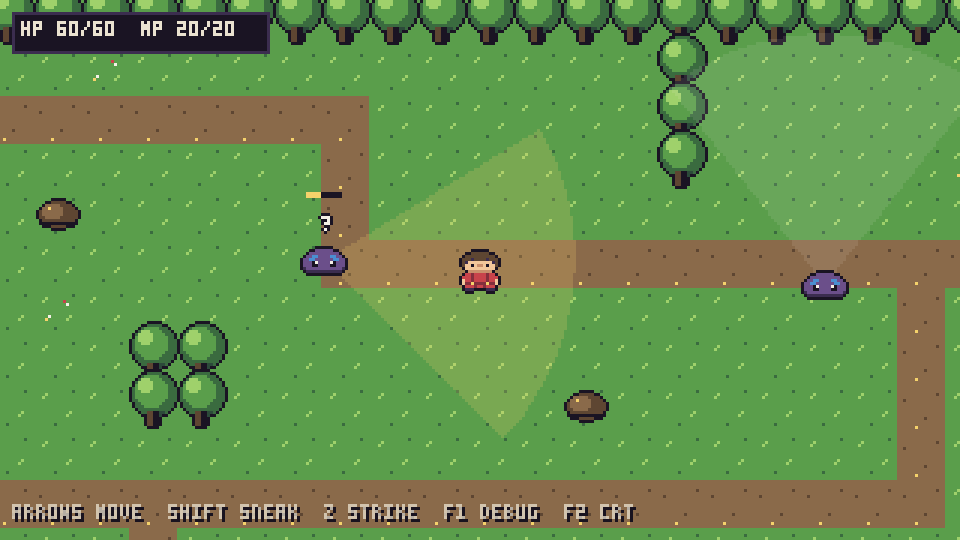
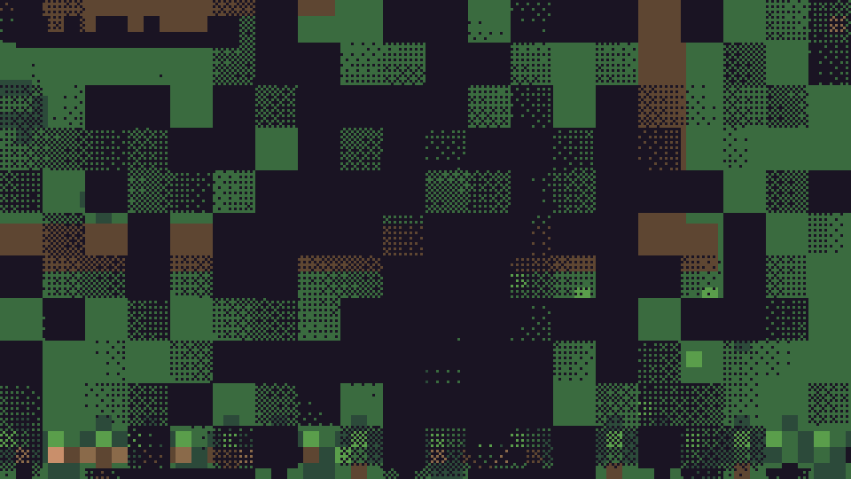
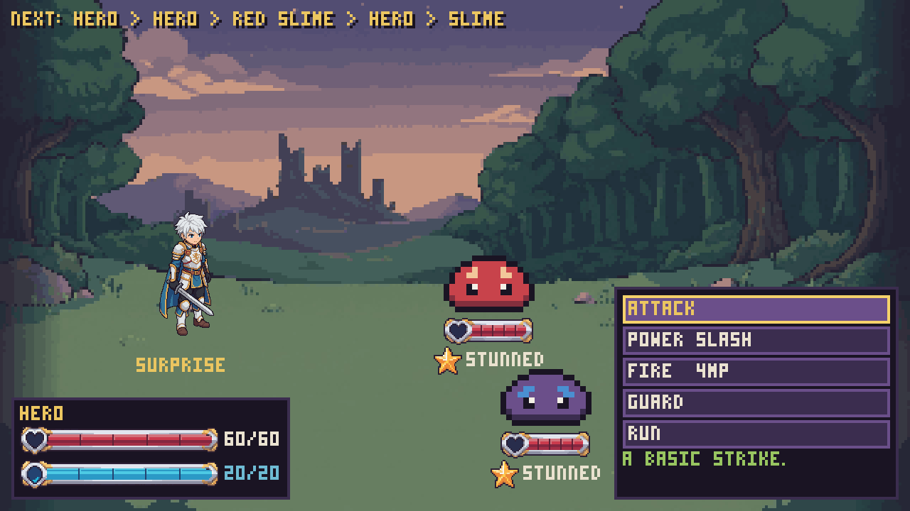

# Clan

Turn-based RPG prototype in **Godot 4.7.2** with **visible overworld enemies** instead of random
encounters (Chrono Trigger / Persona 5 / EarthBound style). This first commit is a playable test:
one small map, three slimes, a full battle loop.

| Overworld | Transition | Battle |
|---|---|---|
|  |  |  |

## Play

Open the folder in Godot 4.7.2 and press **F5**.

| Key | Action |
|---|---|
| Arrows / WASD | move |
| Shift | sneak (slower, enemies notice you half as fast and can't hear you) |
| Z / Space / J | strike — hit a slime **from behind before it sees you** for a surprise attack |
| F1 | debug overlay (enemy states, awareness, hero stats) |
| F2 | palette + CRT filter |
| Arrows + Enter / mouse | battle menus |

* Hit an unaware enemy from behind → **SURPRISE ATTACK**: you act first with +SPD/+ATK, enemies lose their first turn.
* Get caught from behind while it chases you → **AMBUSHED**: enemies act first, you're Off-Guard and can't run yet.
* Anything else → normal battle. HP, MP, cooldowns and Poison carry back to the overworld.

## Layout

```
art/clan.px.js        all pixel art, palette and UI font (claude-pxl source)
assets/sprites/       generated PNGs (tools/sync_art.sh rebuilds them)
data/                 skills, statuses, combatants (.tres, balance lives here)
scenes/               overworld/, battle/
scripts/autoload/     GameState, BattleTransition (BattleTransitionManager)
scripts/skills/       SkillData, StatusEffectData, Combatant, SkillExecutor, TurnQueue, EncounterRules
scripts/overworld/    OverworldMap, OverworldPlayer, OverworldEnemy
scripts/battle/       BattleManager, BattleActorView
shaders/              battle_transition, palette_crt, hit_flash
tests/                test_runner (headless checks), capture (screenshots)
docs/ARCHITECTURE.md  node tree, system specs, shader guide
```

## Tests

```sh
godot --headless --path . res://tests/test_runner.tscn
```

## Art pipeline

```sh
git clone https://github.com/crsolver/claude-pxl ../claude-pxl   # Node >= 22.18
PXL=../claude-pxl tools/sync_art.sh
```

## Credits

* [claude-pxl](https://github.com/crsolver/claude-pxl) (MIT) — pixel-art-as-code tool and 3×5 font used to generate every sprite.
* [ForgeSkills](https://github.com/sekaikx/ForgeSkills) (Apache-2.0) — gameplay-systems, Godot pipeline, testing and impact guidelines followed by the code.
